# VibeCAD-Components

Bibliothèque de composants mécaniques pour [VibeCAD](https://github.com/Barbatronic/VibeCAD), la
CAO 3D paramétrique dans le navigateur ([barbatronic.fr/VibeCAD](https://barbatronic.fr/VibeCAD/)).
Les composants s'insèrent depuis l'interface de VibeCAD, dans une pièce ou un assemblage.

Chaque composant est livré en deux formats :

- **`.vibecad`** : le projet VibeCAD avec son historique paramétrique (esquisses cotées,
  extrusions, poches…), modifiable ;
- **`.step`** : le solide exact, pour FreeCAD, Fusion, Onshape ou tout autre logiciel de CAO.

## Organisation

Un dossier = une **collection** (`bearings/` : les roulements). Un composant = les fichiers de même
nom dans ce dossier :

```
bearings/
  collection.json      nom et description de la collection
  608-2rs.vibecad      modèle VibeCAD (paramétrique)
  608-2rs.step         modèle STEP (solide exact)
  608-2rs.png          vignette 512 × 512, fond transparent
  608-2rs.json         fiche : nom, description, mots-clés, cotes, matière, masse
```

`library.json` décrit la bibliothèque ; `index.json` est le catalogue complet que lit VibeCAD (un
seul fichier à charger). Il est construit par `tools/build-index.mjs`.

## Ajouter une bibliothèque dans VibeCAD

N'importe quel dépôt GitHub organisé de cette façon peut servir de bibliothèque : dans VibeCAD,
Préférences → Bibliothèques → ajouter l'adresse du dépôt.

## Contribuer

1. Ajouter les fichiers du composant dans le dossier de sa collection (au moins un `.vibecad` ou un
   `.step`, et sa vignette `.png`).
2. Lancer `node tools/build-index.mjs` (Node 18 ou plus, sans dépendance) : il met à jour
   `index.json` et le tableau ci-dessous.

Les composants Barbatronic sont générés par VibeCAD lui-même (`npm run library:build` dans le
dépôt VibeCAD, définitions dans `tests/library/components.ts`) : modèles, fichiers STEP, fiches et
vignettes restent cohérents et reproductibles.

## Composants

<!-- composants:début (généré par tools/build-index.mjs) -->
### Roulements (`bearings/`)

Roulements à billes à gorge profonde, avec flasques (2RS).

| | Composant | Fichiers |
|---|---|---|
| 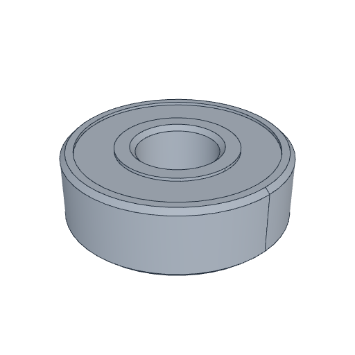 | **Roulement 608-2RS**<br>Roulement à billes 608-2RS : alésage 8 mm, diamètre extérieur 22 mm, largeur 7 mm. | [.vibecad](bearings/608-2rs.vibecad) · [.step](bearings/608-2rs.step) |
| 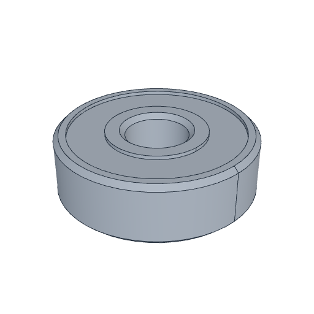 | **Roulement 625-2RS**<br>Roulement à billes 625-2RS : alésage 5 mm, diamètre extérieur 16 mm, largeur 5 mm. | [.vibecad](bearings/625-2rs.vibecad) · [.step](bearings/625-2rs.step) |
| 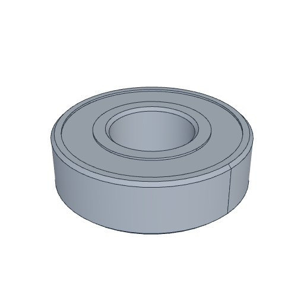 | **Roulement 6001-2RS**<br>Roulement à billes 6001-2RS : alésage 12 mm, diamètre extérieur 28 mm, largeur 8 mm. | [.vibecad](bearings/6001-2rs.vibecad) · [.step](bearings/6001-2rs.step) |
| 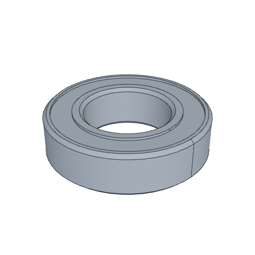 | **Roulement 6800-2RS**<br>Roulement à billes 6800-2RS : alésage 10 mm, diamètre extérieur 19 mm, largeur 5 mm. | [.vibecad](bearings/6800-2rs.vibecad) · [.step](bearings/6800-2rs.step) |

### Accouplements (`couplers/`)

Accouplements rigides entre deux arbres, avec vis de pression.

| | Composant | Fichiers |
|---|---|---|
| 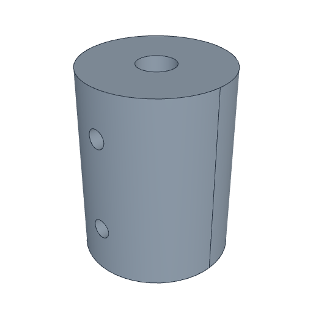 | **Accouplement rigide 5 / 5 mm**<br>Accouplement rigide Ø 19 × 25 mm entre un arbre de 5 mm et un arbre de 5 mm, deux vis de pression M3. | [.vibecad](couplers/rigid-5x5.vibecad) · [.step](couplers/rigid-5x5.step) |
| 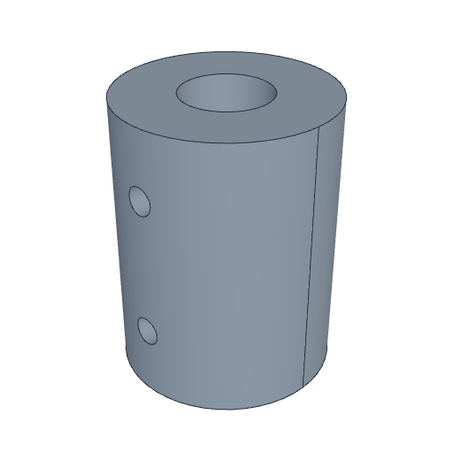 | **Accouplement rigide 5 / 8 mm**<br>Accouplement rigide Ø 19 × 25 mm entre un arbre de 5 mm et un arbre de 8 mm, deux vis de pression M3. | [.vibecad](couplers/rigid-5x8.vibecad) · [.step](couplers/rigid-5x8.step) |

### Moteurs (`motors/`)

Moteurs pas à pas NEMA, avec centreur, arbre et taraudages de fixation.

| | Composant | Fichiers |
|---|---|---|
| 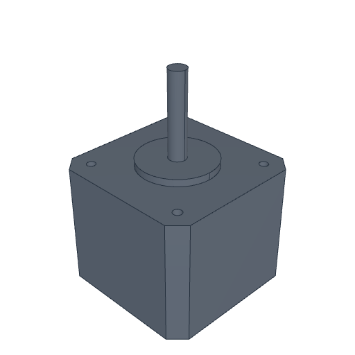 | **Moteur NEMA 17 × 34 mm**<br>Moteur pas à pas NEMA 17, corps de 34 mm, arbre Ø 5 × 24 mm, centreur Ø 22 mm, 4 taraudages M3 à 31 mm d'entraxe. | [.vibecad](motors/nema17-34.vibecad) · [.step](motors/nema17-34.step) |
| 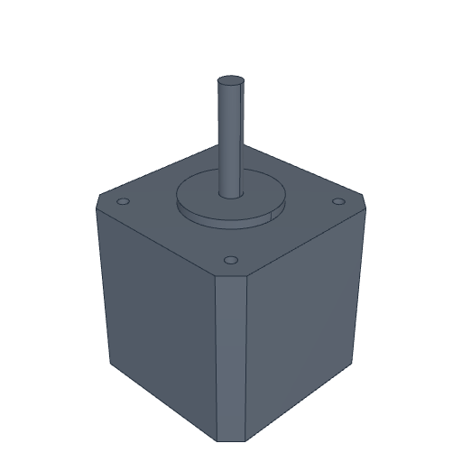 | **Moteur NEMA 17 × 40 mm**<br>Moteur pas à pas NEMA 17, corps de 40 mm, arbre Ø 5 × 24 mm, centreur Ø 22 mm, 4 taraudages M3 à 31 mm d'entraxe. | [.vibecad](motors/nema17-40.vibecad) · [.step](motors/nema17-40.step) |
| 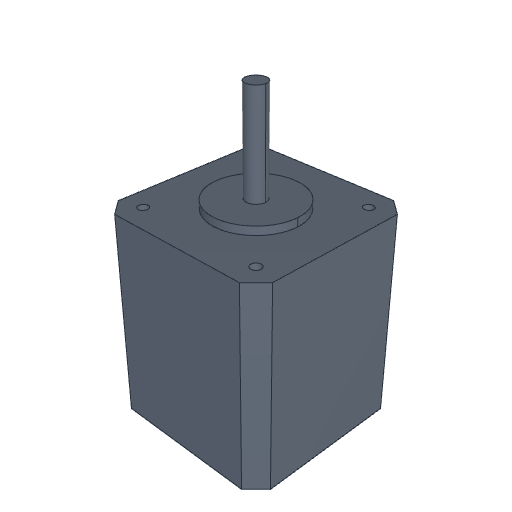 | **Moteur NEMA 17 × 48 mm**<br>Moteur pas à pas NEMA 17, corps de 48 mm, arbre Ø 5 × 24 mm, centreur Ø 22 mm, 4 taraudages M3 à 31 mm d'entraxe. | [.vibecad](motors/nema17-48.vibecad) · [.step](motors/nema17-48.step) |

### Poulies (`pulleys/`)

Poulies crantées GT2 pour courroie de 6 mm, alésage 5 mm.

| | Composant | Fichiers |
|---|---|---|
| 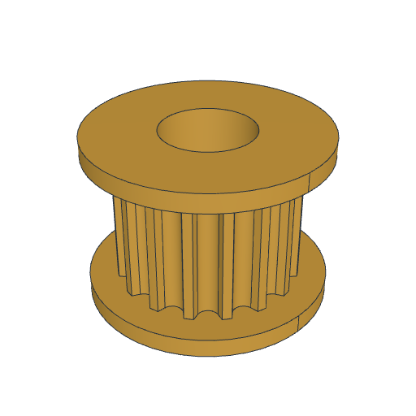 | **Poulie GT2 16 dents**<br>Poulie crantée GT2 16 dents pour courroie de 6 mm, alésage 5 mm, avec flasques. | [.vibecad](pulleys/gt2-16t-5mm.vibecad) · [.step](pulleys/gt2-16t-5mm.step) |
| 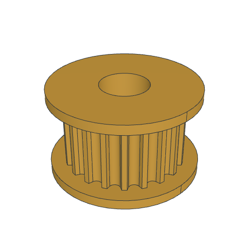 | **Poulie GT2 20 dents**<br>Poulie crantée GT2 20 dents pour courroie de 6 mm, alésage 5 mm, avec flasques. | [.vibecad](pulleys/gt2-20t-5mm.vibecad) · [.step](pulleys/gt2-20t-5mm.step) |
| 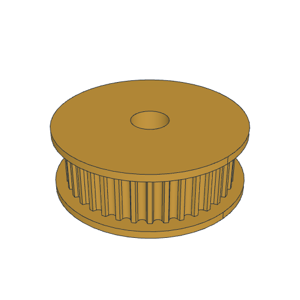 | **Poulie GT2 36 dents**<br>Poulie crantée GT2 36 dents pour courroie de 6 mm, alésage 5 mm, avec flasques. | [.vibecad](pulleys/gt2-36t-5mm.vibecad) · [.step](pulleys/gt2-36t-5mm.step) |
<!-- composants:fin -->

## Licence

[MIT](LICENSE). Les modèles reproduisent des dimensions normalisées ou celles des fiches
techniques des fabricants ; ils sont indicatifs, vérifiez les cotes avant fabrication.
